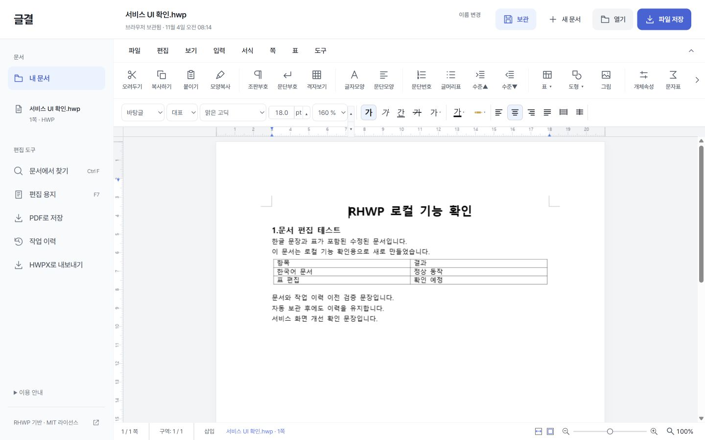

# 글결 · RHWP Workspace

RHWP 오픈소스를 바탕으로 만든 한국어 HWP/HWPX 문서 편집 작업 공간입니다. 파일을 브라우저에서 열고 수정하여 내려받습니다.

**현재 공개 범위: GitHub 소스 + 로컬 실행. 사용자의 요청에 따라 Coders.kr에는 배포하지 않습니다.**



[내 문서 보관함](screenshots/library-desktop.jpg) · [이전 이력 비교](screenshots/history-migration.jpg) · [모바일 보관함](screenshots/library-mobile.jpg)

## 화면과 글꼴

한국어 서비스에 맞춰 Pretendard 400/500/600/700을 각각의 번들 파일로 연결했습니다. 문서 제목 16px, 메뉴 14px, 문서 도구 15px로 위계를 나누고 흰색·회색 면과 파란색 주요 버튼을 사용합니다. 사각 글자 로고와 다색 툴바 그림을 자체 워드마크·단색 SVG로 정리하고, 내 문서는 구분선 목록으로 표시합니다. 문서 본문의 글꼴·서식은 화면용 글꼴과 별도로 유지됩니다.

토스의 간결한 서비스 인상을 참고했으며, 글결의 자체 UI와 오픈소스 글꼴로 구현했습니다. 별도 TDS 의존성이나 토스 전용 폰트·로고는 포함하지 않습니다. 모바일 주요 버튼은 44px이고 메뉴와 서식 도구의 내부 스크롤, 키보드 포커스와 reduced-motion을 지원합니다.

## 구현 기능과 사용 흐름

1. 상단 **열기**로 HWP/HWPX 파일을 선택합니다.
2. 본문, 글자/문단 서식, 표 등 RHWP 편집 기능을 사용합니다.
3. **보관**으로 이 브라우저에 남기거나, **파일 저장**으로 편집본을 다운로드합니다. 파일 메뉴에서 다른 형식을 선택할 수 있습니다.
4. **내 문서**에서 보관본을 열거나, 다른 PC에서는 글결 백업을 가져와 작업을 이어갑니다.

새 문서, 파일명/저장 필요 표시, 문서에서 찾기, 편집 용지, PDF 인쇄, 자동 저장 복구 등 기존 기능을 연결했습니다. 왼쪽 문서 패널은 작은 화면에서 접을 수 있으며, 기존 메뉴와 단축키를 유지합니다. 브라우저 간 일관성을 위해 파일 입력과 다운로드 방식으로 저장합니다. 원본 파일을 자동 덮어쓰지 않습니다.

## 오픈소스 기반과 변경 범위

### 문서 보관과 작업 공간 이전 (v0.2)

- **보관**: 현재 문서를 이 브라우저의 내 문서에 저장합니다. 한 번 보관한 문서는 편집 후 약 1.6초의 대기 시간을 두고 보관본을 갱신합니다. 파일 저장 필요 상태는 별도로 유지합니다.
- **이름 변경**: 현재 형식(HWP/HWPX)을 유지하면서 이름을 바꿉니다. 보관된 문서는 보관함 이름도 갱신합니다.
- **내 문서**: 파일 재선택 없이 보관본을 재열고, 이름으로 검색하거나 보관본만 삭제할 수 있습니다.
- **문서 가져오기**: 여러 HWP/HWPX 원본을 한 번에 보관함으로 옮깁니다. 원본 이름과 파일 수정 시각을 보존하며 기존 파일을 덮어쓰지 않습니다.
- **HWPX로 내보내기**: 기존 RHWP 저장 명령과 손실 경고를 재사용합니다. 원본 파일은 덮어쓰지 않습니다.
- **백업 내보내기/가져오기**: 다른 브라우저·PC·설치에서 문서와 저장된 작업 이력을 함께 옮깁니다. 백업에는 실제 문서 내용, 이력의 메모·원본 이름·시각·IR 스냅샷 또는 구형 HWP 바이트가 포함됩니다. 현재 편집본은 먼저 보관하세요.
- **이전 작업 가져오기**: 같은 브라우저/동일 출처의 `rhwpStudioAutosave` 복구본과 `rhwpStudioDocHistory` 작업 이력을 복사합니다. 기존 데이터는 삭제하지 않습니다. 이력은 기존 **작업 이력 → 선택과 현재 문서 비교**에서 사용할 수 있습니다.

보관 한도는 항목당 20MB, 문서 50개·이전 작업 이력 100개, 문서와 이전 이력 합계 50MB입니다. 암호 문서는 평문으로 보관하지 않으며, 엔진이 내용 손실을 보고하면 보관을 중단합니다. IndexedDB 실패를 메모리 저장 성공으로 표시하지 않습니다.

이전 절차:

1. 필요한 원본 HWP/HWPX는 **내 문서 → 문서 가져오기**로 추가합니다. 현재 편집본은 **보관**합니다.
2. 이전 RHWP 데이터가 있는 주소에서 이 버전을 실행하고 **내 문서 → 이전 작업 가져오기**를 선택합니다. **작업 이력**에서 저장한 버전도 백업에 포함됩니다.
3. **내 문서 → 백업 내보내기**로 `글결-문서백업.json`을 받습니다.
4. 새 브라우저에서 글결을 열고 **내 문서 → 백업 가져오기**를 선택합니다.
5. 형식·버전·파일 크기·SHA-256·이력 구조 검증이 모두 끝난 뒤 문서와 이력을 하나의 트랜잭션으로 추가합니다.
6. 같은 이름이라도 내용이 다르면 별도 문서로 남기고, 이름과 내용이 같은 문서는 건너뜁니다. 같은 메모·원본 이름·시각·내용의 이력도 건너뜁니다. 기존 보관본은 덮어쓰지 않습니다.

백업 v1만 지원하며, 이력 없는 초기 v1 백업도 읽습니다. 백업 파일은 72MB까지 가져옵니다. 알 수 없는 버전, 손상된 데이터, 용량 초과는 기존 보관함을 바꾸지 않고 오류로 안내합니다. SHA-256은 손상 확인용이며 작성자를 인증하지 않습니다. 문서는 확장자와 컨테이너 시그니처를 검사하며 실제 문서 파싱은 RHWP로 열 때 수행합니다.

**작업 이력의 의미:** 저장된 버전과 복구본을 이전합니다. 편집 세션의 Ctrl+Z 실행 취소 스택이나 한컴 한글 앱 내부 기록은 가져오지 않습니다. IR 스냅샷의 문단 식별자는 보존하지만 문서를 다시 열어 식별자가 달라지면 기존 비교 엔진이 정렬 비교로 처리할 수 있습니다. 이력은 버전 비교 자료이며 문서 전체 복원용 파일을 대신하지 않습니다.

브라우저 보안 경계 때문에 다른 웹사이트·다른 포트의 IndexedDB를 자동으로 읽을 수 없습니다. 원래 주소에서 백업을 내보내거나 원본 파일을 선택해야 합니다. 이름만 있는 최근 문서 목록에서 파일 내용을 복원하지 않습니다.

내 문서는 해당 브라우저/출처에만 남습니다. 브라우저 데이터 삭제·시크릿 모드 종료·저장소 정리 등에 대비해 백업을 별도 보관하세요. 다중 탭에서 같은 보관본을 동시에 편집하는 협업은 지원하지 않습니다.

참고한 자료와 제품에 적용한 근거는 [SOURCES.md](SOURCES.md)에 기록했습니다.

- 원본: [edwardkim/rhwp](https://github.com/edwardkim/rhwp), MIT. 원 저작권 및 라이선스는 [vendor/RHWP-LICENSE](vendor/RHWP-LICENSE)에 보존했습니다.
- TypeScript UI 소스 기준: `df39fb5d7a566ba6a49c2f6a04965616d2c2af73`의 `rhwp-studio`.
- UI는 실제 소스로 빌드하며 `workspace-shell.ts`와 `workspace.css`에서 화면을 수정할 수 있습니다.
- 문서 엔진 JS/WASM은 공식 Pages의 v0.8.7 배포물을 변경 없이 재사용합니다. Rust 엔진을 이 저장소에서 새로 컴파일하지 않습니다. UI 소스 커밋과 엔진 빌드 커밋이 같다고 주장하지 않습니다.
- 바이너리 출처/체크섬/수정 경계: [vendor/UPSTREAM.json](vendor/UPSTREAM.json).
- 번들 글꼴별 고지: [vendor/FONTS.md](vendor/FONTS.md), [vendor/font-licenses](vendor/font-licenses).
- 이 저장소는 별도 제품 커스터마이징 프로젝트입니다. 원본 RHWP에 변경 사항을 제출한 것은 아닙니다.

## 기술과 구조

TypeScript, Vite, RHWP Rust/WebAssembly, HTML/CSS, Node.js 정적 서버. 문서 처리용 서버/데이터베이스는 없습니다.

```text
frontend/src/core/      원본 문서 브리지와 상태
frontend/src/engine/    원본 편집/입력 처리
frontend/src/view/      문서 캔버스
frontend/src/ui/workspace-shell.ts  글결 작업 공간
frontend/src/styles/workspace.css  글결 디자인 토큰/반응형
frontend/src/workspace/ 문서 보관·백업 형식·이력 이전·대화상자
tests/library.test.ts   백업 검증·중복·저장 실패 원자성 테스트
frontend/public/fonts/  번들 글꼴
pkg/                   공식 문서 엔진 JS/WASM 및 타입
vendor/                출처와 라이선스
server.mjs             정적 서버 및 /healthz
Dockerfile             프론트 빌드 후 비루트 사용자로 서비스
coders.yaml            Coders.kr 서비스 설정
design.md              화면 설계와 검증 계획
```

## 로컬 실행

Node.js 22.12 이상과 npm이 필요합니다.

```sh
npm ci
npm run dev
```

개발 주소: http://127.0.0.1:7720

```sh
npm test
npm run typecheck
npm run build
npm start
```

빌드 후 실행 주소도 http://127.0.0.1:7720 입니다. 상태 확인은 `/healthz`입니다. 개발 중 Vite가 변경을 반영합니다. 정적 서버에서는 빌드 후 브라우저를 새로고침합니다.

## 환경 변수와 외부 연동

| 이름 | 목적 | 필수 | 설정 위치 |
|---|---|---|---|
| PORT | 정적 서버 포트, 기본 7720 | 아니요 | 로컬 셸 또는 Coders가 서비스 포트 8080 주입 |
| HOST | 바인딩 주소, 기본 127.0.0.1 | 아니요 | Dockerfile에서 0.0.0.0 |

외부 API 키와 서버 데이터베이스는 필요하지 않습니다. 내 문서는 브라우저 IndexedDB를 사용합니다. 글결 백업 파일과 이전 RHWP 복구본을 가져오는 마이그레이션은 아래 절차를 참고하세요. OAuth나 공식 한컴 서비스 연동은 구현하지 않았습니다.

## 검증

- `npm run build`: TypeScript 검사 및 Vite production build.
- `npm test`: 문서/이력 백업 왕복, 변조 거부, 중복 방지, IndexedDB 실패 시 전체 취소와 v1 저장소 업그레이드 등 11개 통과.
- 별도 로컬 출처 7720 → 7721에서 문서 2개·이력 1개 이전 후 실제 문서 열기/이력 비교 확인. 7721은 검증용이며 기본 실행 주소는 7720입니다.
- 브라우저에서 HWPX 열기 → 문장 추가 → 저장 후 CLI 재파싱에서 추가 문장과 표 보존 확인.
- 360×800, 390×844, 768×1024, 1440×900에서 화면, 페이지 넘침과 주요 조작 확인.
- 전체 엔진 회귀 테스트 및 Rust 빌드는 수행하지 않았습니다.
- 검증 상세/미검증 항목은 [VERIFICATION.md](VERIFICATION.md)를 참고하세요.

## 게시 범위

현재 작업은 사용자 GitHub 저장소에만 커밋·푸시합니다. Coders.kr 인증·배포·재배포는 수행하지 않습니다. Dockerfile과 coders.yaml은 기존 참고 설정이며 이번 변경에서 실행하지 않습니다.

## 저장소

- canonical / origin: https://github.com/boclair98/rhwp-workspace
- 기본 브랜치: main
- 이전 단계에서 생성한 조직 fork는 기존 상태로 보존합니다. 이번 요청은 사용자 GitHub에만 반영하므로 조직 fork 동기화와 배포는 하지 않습니다.

## 보안과 한계

문서 내용을 서버에 업로드하는 API가 없습니다. 최근 문서와 복구본은 브라우저 저장소를 사용하므로 공용 PC에서는 주의하세요. 글꼴, 지원 형식, 원본 문서 구조에 따라 표시나 저장 결과가 달라질 수 있습니다. 복잡한 표/수식/개체, 실제 한국어 IME 조합, 한컴 한글과의 완전한 서식 호환성은 보장하지 않습니다. PDF 출력은 브라우저 인쇄를 사용합니다. 공동 편집, 클라우드 문서 동기화, 계정별 저장은 제공하지 않습니다.

MIT 라이선스로 사용/수정/배포할 수 있으며 포함된 원본·글꼴별 라이선스 고지를 보존해야 합니다.
