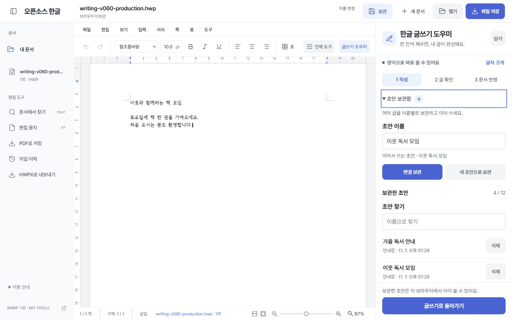

# 오픈소스 한글 · RHWP Workspace

> **v0.7.0 · 코더스에서 AI 글쓰기.** RHWP 기반 HWP/HWPX 편집기입니다. AI로 새 글을 쓰거나 선택한 문장을 다듬고, 미리보기에서 확인한 뒤 문서에 넣을 수 있습니다.

[오픈소스 한글 열기](https://rhwp-workspace.coders.kr) · [운영 상태 확인](https://rhwp-workspace.coders.kr/healthz)

## 한글 글쓰기 도우미

PC에서는 오른쪽 패널이나 도구 모음의 **글쓰기 도우미**, 작은 화면에서는 **글쓰기** 버튼을 사용합니다. 기존 한글처럼 문서 중심의 메뉴·서식·전체 도구를 유지하며 도우미는 닫거나 다시 열 수 있습니다.

1. **작성**에서 새 글 양식을 고르고 필요한 항목을 채웁니다. 선택 항목은 펼쳐서 적습니다. 직접 쓴 글도 넣을 수 있습니다. **문장 다듬기**는 본문 또는 표 셀 한 문단 안에서 최대 2,000자를 선택해 시작합니다.
2. **글 확인**에서 문서에 넣을 글을 바로 고치고 글자·줄 수를 확인합니다. 새 글은 최대 2,000자·16줄입니다. 문장 다듬기에서는 **원문과 비교**를 펼쳐 바뀐 문장을 확인합니다. 문서, 작성 모드, 작성 화면의 입력 내용이 달라져도 확인하던 글은 남습니다. 적용 위치 안내가 나오면 문서에서 넣을 위치나 바꿀 문장을 고른 뒤 **현재 위치 다시 확인**을 누릅니다.
3. **문서에 넣기**를 누르면 **문서 반영**이 완료됩니다. 다듬은 문장은 선택 첫 글자의 서식을 따릅니다. 적용은 한 번의 Ctrl+Z로 되돌릴 수 있습니다. 완료 화면의 **파일 저장**으로 현재 문서를 내려받습니다.

**초안 보관함**을 열어 이름을 적고 **초안 보관**을 누릅니다. 작성 모드, 양식과 입력값, 요청 문구, 직접 쓴 글, 미리보기가 같은 주소의 브라우저 저장소에 남습니다. 이름을 검색하거나 최근 보관 순으로 글을 찾을 수 있습니다. 목록에서 글을 열고 확인한 뒤 **불러오기**를 누르면 도우미에서 이어 쓸 수 있습니다. **변경 보관**은 선택한 초안을 갱신하고, **새 초안으로 보관**은 이름이 같아도 별도 항목으로 만듭니다. 삭제할 때는 대상 이름을 한 번 더 확인합니다.

**초안 백업·이전 → 초안 백업**으로 보관함의 글을 JSON 파일로 내려받고, 새 브라우저에서 **초안 가져오기**로 선택합니다. 이름과 내용이 모두 같은 항목은 건너뛰고 나머지를 보관함에 추가합니다. 파일은 500KB, 보관함은 12개 한도입니다. 글과 작성 정보가 담기므로 보관할 장소를 골라 주세요. 한글 파일과 작업 이력은 **내 문서 → 백업·이전**에서 옮깁니다.

v0.5에서 보관한 글은 같은 주소에서 **이전에 보관한 초안**으로 열립니다. 보관함에서 처음 변경 사항을 저장할 때 새 형식으로 옮깁니다. 열어 둔 이전 버전의 편집기는 새로고침해서 사용하세요. 불러온 글을 문서에 넣으려면 위치를 확인하고 **문서에 넣기**를 누릅니다. 초안에 담는 데이터는 이름, 글, 작성 설정입니다.

**글자 크게**를 켜면 도우미 본문과 입력이 18px로 커지며 같은 브라우저에서 설정을 기억합니다. 기본 입력은 16px, 주요 버튼 높이는 48px입니다. 모바일 하단 시트는 키보드 포커스 순환과 복귀를 지원합니다. 문서 자체의 글꼴과 크기는 서식 도구로 조절합니다.

### 운영 사이트에서 AI 쓰기

- **새 글:** 글쓰기 도우미에서 **새 글 쓰기 → AI에 부탁하기**를 선택하고, 어떤 글이 필요한지 적습니다.
- **문장 다듬기:** 본문이나 표 셀에서 문장을 선택한 뒤 **문장 다듬기**를 열고 원하는 변경을 적습니다.
- 로그인이 필요하면 **코더스 로그인**을 눌러 새 탭에서 로그인하고 편집기로 돌아옵니다. 입력란이 보이지 않으면 **로그인 확인**을 누릅니다. 전송에 동의하고 생성한 뒤 **글 확인 → 문서에 넣기**로 적용합니다.

방문자가 API 키를 입력할 필요는 없습니다. 기본 운영 모드에서는 코더스 관리형 AI가 로그인한 방문자의 이용 한도를 적용합니다. 전송에 동의한 요청에서 새 글은 요청 문구만, 문장 다듬기는 선택 문장과 요청 문구만 코더스를 거쳐 OpenAI에 보냅니다. 문서 파일, 나머지 본문, 보관함은 이 경로로 전송되지 않습니다. 양식·직접 쓰기·편집·저장은 브라우저에서 처리합니다. [코더스 관리형 AI 안내](https://coders.kr/managed-ai.txt)

실행은 아래 `npm run dev` 또는 빌드 후 `npm start`를 사용합니다. 기본 주소는 http://127.0.0.1:7720 입니다. 다른 포트는 PowerShell에서 `$env:PORT='7722'; npm start`로 지정할 수 있습니다.

### 개인용 로컬 AI를 연결할 때

프로젝트 루트 `.env.local`에 키를 직접 입력한 뒤 서버를 재시작합니다. 이 파일이 없으면 `.env.example`을 복사해 만듭니다. `.env.local`은 Git에서 제외됩니다. 키 값은 채팅·소스·스크린샷에 넣지 마세요.

| 변수 | 목적 | 기본/필수 |
|---|---|---|
| AI_ENABLED | 외부 AI 요청 활성화 | 기본 false, 연결 시 true |
| OPENAI_API_KEY | 서버에서만 쓰는 OpenAI 프로젝트 키 | 연결 시 필수, OpenAI Platform에서 발급 |
| OPENAI_MODEL | Responses와 구조화 출력을 지원하는 모델 ID | 연결 시 필수, 접근 가능한 모델을 지정 |

모델 ID 예시는 `.env.example`에 있습니다. API 상태는 `GET /api/ai/status`, 초안 생성은 `POST /api/ai/draft`, 문장 다듬기는 `POST /api/ai/rewrite`입니다. 공급자 요청은 저장 옵션을 `false`로 설정하고 구조화 출력을 사용합니다. [OpenAI Responses API](https://developers.openai.com/api/docs/guides/migrate-to-responses) · [구조화 출력](https://developers.openai.com/api/docs/guides/structured-outputs)

개인용 로컬 키를 사용하는 서버는 루프백 주소에서 같은 출처의 요청만 처리합니다. 운영 AI는 코더스 게이트가 확인한 사용자와 운영 출처가 모두 있어야 생성 요청을 처리합니다. 관리형 인증에 문제가 있어도 로컬 키로 자동 전환하지 않습니다. 모든 모드에서 요청 크기와 길이, 사용자당 동시 1건·분당 6건, 45초 제한을 적용합니다. `vite preview`에는 API 처리가 없으므로 `npm run dev` 또는 `npm start`를 사용하세요.

글쓰기 도우미의 코드와 테스트 경로는 아래 기술 구조에 정리했습니다. [글쓰기 도우미 검증 기록](AI_PANEL_CHECKS.md).

RHWP 오픈소스를 바탕으로 만든 독립 HWP/HWPX 문서 편집기입니다. 한컴의 공식 제품이나 제휴 서비스가 아닙니다. 이전 이름 ‘글결’의 문서와 백업을 그대로 읽습니다. 파일을 브라우저에서 열고 수정하여 내려받습니다.

v0.6.0에서는 운영 주소에서 이전 초안 확인, 로컬 백업 가져오기, 위치 확인 후 문서 반영, HWP 저장과 재열기를 검증했습니다.



[v0.6 모바일 초안 보관함](screenshots/writing-v060-mobile.jpg) · [v0.5 미리보기 편집 화면](screenshots/writing-v050-desktop.png)

[v0.5 모바일 글 확인 화면](screenshots/writing-v050-mobile.png) · [v0.4 편집 화면](screenshots/writing-v040-desktop.png)

[글쓰기 도우미 모바일 미리보기](screenshots/writing-v040-mobile.png) · [이전 버전 편집 화면](screenshots/production-desktop.jpg). 직접 작성한 시험용 모임 공지로 실제 동작을 확인한 화면입니다.

[내 문서 보관함](screenshots/production-library-desktop.jpg) · [모바일 보관함](screenshots/production-library-mobile.jpg) · [모바일 서식 창](screenshots/production-mobile-format.jpg) · [모바일 배율](screenshots/production-mobile-zoom.jpg) · [모바일 표 입력](screenshots/production-mobile-table.jpg) · [가로 화면](screenshots/production-mobile-landscape.jpg) · [v0.2 이전 이력 비교 기록](screenshots/history-migration.jpg)

운영 검증 화면: [PC 보관함](screenshots/production-library-desktop.jpg) · [모바일 보관함](screenshots/production-library-mobile.jpg) · [360px](screenshots/production-mobile-360.jpg) · [390px](screenshots/production-mobile-390.jpg) · [태블릿](screenshots/production-tablet.jpg). 화면 속 문서는 직접 만든 기능 확인용 문서입니다.

## 화면과 글꼴

**v0.3 간편 편집**: 자주 쓰는 글꼴·크기·굵게·정렬·실행 취소를 한 줄에 배치했습니다. **전체 도구**를 펼치면 기존 메뉴와 리본을 계속 사용할 수 있습니다. PC 문서 패널도 접을 수 있습니다. 모바일은 **서식** 창에서 글자·문단과 배율을 조절하고 **폭 맞춤**으로 종이를 볼 수 있습니다.

**내 문서**: 파일명 영역 전체를 눌러 열고, 이름 검색·HWP/HWPX 필터·최근 수정/이름 정렬을 사용합니다. 백업 작업은 **백업·이전**을 펼쳐 선택합니다.

한국어 서비스에 맞춰 Pretendard 400/500/600/700을 각각의 번들 파일로 연결했습니다. 문서 제목 16px, 메뉴 14px, 문서 도구 15px로 위계를 나누고 흰색·회색 면과 파란색 주요 버튼을 사용합니다. 이름 워드마크와 Lucide 단색 SVG로 도구 모음을 정리하고, 내 문서는 구분선 목록으로 표시합니다. 문서 본문의 글꼴·서식은 화면용 글꼴과 별도로 유지됩니다.

토스의 간결한 서비스 인상을 참고했으며, 오픈소스 한글의 자체 UI와 오픈소스 글꼴로 구현했습니다. 별도 TDS 의존성이나 토스 전용 폰트·로고는 포함하지 않습니다. 모바일 주요 버튼은 44px이고 메뉴와 서식 도구의 내부 스크롤, 키보드 포커스와 reduced-motion을 지원합니다.

## 실제 HWP 검증과 모바일 보완 (v0.3.1)

공개 HWP 3개(한컴 2010/2018/2020 저장 메타데이터)를 실제로 편집·다운로드·재파싱했습니다. 6쪽/표 9개 문서는 본문과 새 표를 추가한 뒤 6쪽/표 10개가 유지됐고, 독후감은 모바일에서 적용한 12pt·굵게가 HWP 재열기 후에도 남았습니다. 번호·글머리표 문구 수정과 세 HWP의 기존 본문 보존도 확인했습니다.

문서 준비 중에는 로딩 안내와 조작 잠금을 제공해 입력 가능한 시점을 구분합니다. 운영에서 준비 완료 직후 입력한 두 문장과 새 표의 두 셀을 HWP로 저장해 6개 조건을 모두 통과했습니다. 모바일 하단 쪽/배율 조작 44px, 짧은 배율 창, 회전 시 맞춤 유지, 서식→표 만들기, 표 생성 후 즉시 입력과 키보드 메뉴를 보완했습니다. 작은 글자는 하단 배율에서 100% 이상으로 확대해 볼 수 있습니다. **독후감 HWPX 변환본은 1→2쪽으로 배치가 달라지는 한계가 남아 있습니다.** HWPX 변환 시 이를 안내하며 원래 서식 유지에는 HWP 저장을 사용하세요. [실제 파일·모바일 상세 결과와 한계](HWP_CHECKS.md).

## 구현 기능과 사용 흐름

1. 상단 **열기**로 HWP/HWPX 파일을 선택합니다.
2. 본문, 글자/문단 서식, 표 등 RHWP 편집 기능을 사용합니다.
3. **보관**으로 이 브라우저에 남기거나, **파일 저장**으로 편집본을 다운로드합니다. 파일 메뉴에서 다른 형식을 선택할 수 있습니다.
4. **내 문서**에서 보관본을 열거나, 다른 PC에서는 오픈소스 한글 백업을 가져와 작업을 이어갑니다.

새 문서, 파일명/저장 필요 표시, 문서에서 찾기, 편집 용지, PDF 인쇄, 자동 저장 복구 등 기존 기능을 연결했습니다. 왼쪽 문서 패널은 작은 화면에서 접을 수 있으며, 기존 메뉴와 단축키를 유지합니다. 브라우저 간 일관성을 위해 파일 입력과 다운로드 방식으로 저장합니다. 원본 파일을 자동 덮어쓰지 않습니다.

## 오픈소스 기반과 변경 범위

### 문서 보관과 작업 공간 이전 (v0.2)

- **보관**: 현재 문서를 이 브라우저의 내 문서에 저장합니다. 한 번 보관한 문서는 편집 후 약 1.6초의 대기 시간을 두고 보관본을 갱신합니다. 파일 저장 필요 상태는 별도로 유지합니다.
- **이름 변경**: 현재 형식(HWP/HWPX)을 유지하면서 이름을 바꿉니다. 보관된 문서는 보관함 이름도 갱신합니다.
- **내 문서**: 파일 재선택 없이 보관본을 재열고, 이름으로 검색하거나 보관본만 삭제할 수 있습니다.
- **문서 가져오기**: 여러 HWP/HWPX 원본을 한 번에 보관함으로 옮깁니다. 원본 이름과 파일 수정 시각을 보존하며 기존 파일을 덮어쓰지 않습니다.
- **HWPX로 내보내기**: 기존 RHWP 저장 명령과 손실 경고를 재사용합니다. 원본 파일은 덮어쓰지 않습니다.
- **백업 내보내기/가져오기**: 다른 브라우저·PC·설치에서 문서와 저장된 작업 이력을 함께 옮깁니다. 백업에는 실제 문서 내용, 이력의 메모·원본 이름·시각·IR 스냅샷 또는 구형 HWP 바이트가 포함됩니다. 현재 편집본은 먼저 보관하세요.
- **이전 작업 가져오기**: 같은 브라우저/동일 출처의 `rhwpStudioAutosave` 복구본과 `rhwpStudioDocHistory` 작업 이력을 복사합니다. 기존 데이터는 삭제하지 않습니다. 이력은 기존 **작업 이력 → 선택과 현재 문서 비교**에서 사용할 수 있습니다.

보관 한도는 항목당 20MB, 문서 50개·이전 작업 이력 100개, 문서와 이전 이력 합계 50MB입니다. 암호 문서는 평문으로 보관하지 않으며, 엔진이 내용 손실을 보고하면 보관을 중단합니다. IndexedDB 실패를 메모리 저장 성공으로 표시하지 않습니다.

이전 절차:

1. 필요한 원본 HWP/HWPX는 **내 문서 → 문서 가져오기**로 추가합니다. 현재 편집본은 **보관**합니다.
2. 이전 RHWP 데이터가 있는 주소에서 이 버전을 실행하고 **내 문서 → 백업·이전 → 이전 작업 가져오기**를 선택합니다. **작업 이력**에서 저장한 버전도 백업에 포함됩니다.
3. **내 문서 → 백업·이전 → 백업 내보내기**로 `오픈소스 한글-문서백업.json`을 받습니다.
4. 새 브라우저에서 오픈소스 한글을 열고 **내 문서 → 백업·이전 → 백업 가져오기**를 선택합니다.
5. 형식·버전·파일 크기·SHA-256·이력 구조 검증이 모두 끝난 뒤 문서와 이력을 하나의 트랜잭션으로 추가합니다.
6. 같은 이름이라도 내용이 다르면 별도 문서로 남기고, 이름과 내용이 같은 문서는 건너뜁니다. 같은 메모·원본 이름·시각·내용의 이력도 건너뜁니다. 기존 보관본은 덮어쓰지 않습니다.

백업 v1만 지원하며, 이력 없는 초기 v1 백업도 읽습니다. 백업 파일은 72MB까지 가져옵니다. 알 수 없는 버전, 손상된 데이터, 용량 초과는 기존 보관함을 바꾸지 않고 오류로 안내합니다. SHA-256은 손상 확인용이며 작성자를 인증하지 않습니다. 문서는 확장자와 컨테이너 시그니처를 검사하며 실제 문서 파싱은 RHWP로 열 때 수행합니다.

**작업 이력의 의미:** 저장된 버전과 복구본을 이전합니다. 편집 세션의 Ctrl+Z 실행 취소 스택이나 한컴 한글 앱 내부 기록은 가져오지 않습니다. IR 스냅샷의 문단 식별자는 보존하지만 문서를 다시 열어 식별자가 달라지면 기존 비교 엔진이 정렬 비교로 처리할 수 있습니다. 이력은 버전 비교 자료이며 문서 전체 복원용 파일을 대신하지 않습니다.

브라우저 보안 경계 때문에 다른 웹사이트·다른 포트의 IndexedDB를 자동으로 읽을 수 없습니다. 원래 주소에서 백업을 내보내거나 원본 파일을 선택해야 합니다. 이름만 있는 최근 문서 목록에서 파일 내용을 복원하지 않습니다.

**로컬 → 운영 주소로 이전:** 로컬 오픈소스 한글의 **내 문서 → 백업·이전 → 백업 내보내기**로 문서·작업 이력을 내려받고, 운영 오픈소스 한글의 **내 문서 → 백업·이전 → 백업 가져오기**에서 선택하세요. 브라우저가 같아도 `localhost`와 운영 도메인의 보관함은 별개입니다. 운영 배포는 문서 내용을 서버 저장이나 계정별 클라우드 동기화로 전환하지 않습니다.

내 문서는 해당 브라우저/출처에만 남습니다. 브라우저 데이터 삭제·시크릿 모드 종료·저장소 정리 등에 대비해 백업을 별도 보관하세요. 다중 탭에서 같은 보관본을 동시에 편집하는 협업은 지원하지 않습니다.

참고한 자료와 제품에 적용한 근거는 [SOURCES.md](SOURCES.md)에 기록했습니다.

- 원본: [edwardkim/rhwp](https://github.com/edwardkim/rhwp), MIT. 원 저작권 및 라이선스는 [vendor/RHWP-LICENSE](vendor/RHWP-LICENSE)에 보존했습니다.
- TypeScript UI 소스 기준: `df39fb5d7a566ba6a49c2f6a04965616d2c2af73`의 `rhwp-studio`.
- UI는 실제 소스로 빌드하며 `workspace-shell.ts`와 `workspace.css`에서 화면을 수정할 수 있습니다.
- 문서 엔진 JS/WASM은 공식 Pages의 v0.8.7 배포물을 변경 없이 재사용합니다. Rust 엔진을 이 저장소에서 새로 컴파일하지 않습니다. UI 소스 커밋과 엔진 빌드 커밋이 같다고 주장하지 않습니다.
- 바이너리 출처/체크섬/수정 경계: [vendor/UPSTREAM.json](vendor/UPSTREAM.json).
- 아이콘: [Lucide](https://lucide.dev), 1.68.0/ISC. [라이선스와 포함 고지](vendor/LUCIDE-LICENSE)를 보존합니다.
- 번들 글꼴별 고지: [vendor/FONTS.md](vendor/FONTS.md), [vendor/font-licenses](vendor/font-licenses).
- 이 저장소는 별도 제품 커스터마이징 프로젝트입니다. 원본 RHWP에 변경 사항을 제출한 것은 아닙니다.

## 기술과 구조

TypeScript, Vite, RHWP Rust/WebAssembly, HTML/CSS, Node.js 정적 서버와 글쓰기 API. 문서 처리용 서버/데이터베이스는 없습니다. 양식·편집·보관은 브라우저에서 처리합니다.

```text
frontend/src/core/      원본 문서 브리지와 상태
frontend/src/engine/    원본 편집/입력 처리
frontend/src/view/      문서 캔버스
frontend/src/ui/workspace-shell.ts  앱 셸과 탐색
frontend/src/ui/workspace-editor-tools.ts 간편 도구/모바일 서식
frontend/src/ui/workspace-dialog.ts 키보드·포커스를 지원하는 대화상자
frontend/src/ui/workspace-ai-panel.ts 글쓰기·비교·적용 패널
frontend/src/ui/workspace-writing-library.ts 이름별 초안 보관함
frontend/src/workspace/writing-templates.ts 외부 전송 없는 글쓰기 양식
frontend/src/workspace/writing-draft-store.ts 초안 보관 형식·검증
frontend/src/workspace/writing-draft-library.ts 초안 목록·이전·백업
frontend/src/workspace/ai-editor.ts 문서 적용·범위 검증·Undo 연결
server/ai-service.mjs   개인용 로컬 및 코더스 운영 글쓰기 API
frontend/src/styles/workspace.css  오픈소스 한글 디자인 토큰/반응형
frontend/src/workspace/ 문서 보관·백업 형식·이력 이전·대화상자
tests/library.test.ts   백업 검증·중복·저장 실패 원자성 테스트
tests/responsive-zoom.test.ts 회전/키보드 높이/수치 배율 보존
tests/writing-draft-store.test.ts 초안 복원·버전·저장 실패 검증
tests/writing-draft-library.test.ts 여러 초안·이전·중복·실패 시 보존 검증
frontend/public/fonts/  번들 글꼴
pkg/                   공식 문서 엔진 JS/WASM 및 타입
vendor/                출처와 라이선스
server.mjs             정적 서버 및 /healthz
Dockerfile             프론트 빌드 후 비루트 사용자로 서비스
coders.yaml            Coders.kr 서비스 설정
design.md              화면 설계와 검증 계획
```

## 로컬 실행

Node.js 22.12 이상과 npm이 필요합니다.

```sh
npm ci
npm run dev
```

개발 주소: http://127.0.0.1:7720

```sh
npm test
npm run typecheck
npm run build
npm start
```

빌드 후 실행 주소도 http://127.0.0.1:7720 입니다. 상태 확인은 `/healthz`입니다. 개발 중 Vite가 변경을 반영합니다. 정적 서버에서는 빌드 후 브라우저를 새로고침합니다.

## 환경 변수와 외부 연동

| 이름 | 목적 | 필수 | 설정 위치 |
|---|---|---|---|
| PORT | 정적 서버 포트, 기본 7720 | 아니요 | 로컬 셸 또는 Coders가 서비스 포트 8080 주입 |
| HOST | 바인딩 주소, 기본 127.0.0.1 | 아니요 | Dockerfile에서 0.0.0.0 |
| AI_RUNTIME | `coders`인 경우 관리형 AI 사용 | 운영 AI 사용 시 | `coders.yaml` |
| CODERS_AI_ORIGIN | 운영 편집기 출처 | 운영 AI 사용 시 | `coders.yaml`의 운영 HTTPS 주소 |
| CODERS_AI_BASE_URL | 관리형 Responses API 기본 경로 | 운영 AI 사용 시 | 코더스가 `coders.yaml`의 AI 리소스에서 서버로 주입 |
| CODERS_AI_TOKEN | 관리형 AI 프로젝트 인증 | 운영 AI 사용 시 | 코더스가 AI 리소스에서 서버로만 주입 |
| CODERS_OPENAI_API_KEY | 운영 서버의 OpenAI 직접 연결용 키 | 직접 연결 선택 시 | 코더스 프로젝트의 서버 비밀 환경 변수에만 등록 |
| CODERS_AGENT_TOKEN | 수동 배포 API 클라이언트의 인증에만 사용 | 수동 API 호출 시 | 코더스 에이전트 승인으로 발급, 애플리케이션 런타임에 주입하지 않음 |

문서 편집·보관에는 API 키와 서버 데이터베이스가 필요하지 않습니다. 코더스 로그인은 플랫폼이 처리합니다. 내 문서는 브라우저 IndexedDB를 사용합니다. 오픈소스 한글 백업 파일과 이전 RHWP 복구본을 가져오는 마이그레이션은 위 절차를 참고하세요.

## 검증

- v0.7.0 자동 테스트 66개와 TypeScript/Vite 빌드가 통과했습니다. 운영 글쓰기·문장 다듬기 HTTP 경로, 로그인·출처·동의 확인, 사용자별 한도, 키와 방문자 식별자 격리를 검사합니다.
- v0.6.0에서 자동 테스트 61개와 TypeScript/Vite 빌드가 통과했습니다. 추가한 10개 테스트는 이전 버전의 초안 이전, 동명 보관, 최신 수정 확인, 백업 왕복, 중복, 손상·한도·저장 실패 시 데이터 보존을 검사합니다.
- v0.5.0에서 `npm run build`의 TypeScript 검사와 Vite 프로덕션 빌드가 통과했습니다. `npm test`는 기존 42개, 문서 적용 위치 검증 3개, 초안 보관 검증 6개로 총 51개가 통과했습니다.
- 로컬 브라우저에서 새 글 반영→HWP 다운로드의 4개 조건, HWP 재열기→선택 문장 수정→다운로드의 4개 조건, 모바일 기존 HWP 문서에 글 추가의 5개 조건을 확인했습니다.
- 로컬에서 360×800, 390×844, 768×1024, 1440×900, 가로 700×390 화면을 스크린샷으로 확인했습니다. 페이지 가로 넘침 0건, 콘솔 오류 0건이었으며 입력 16px/큰 글자 18px, 주요 버튼 48px, Tab·Shift+Tab·Escape 조작을 확인했습니다.
- 별도 로컬 출처 7720 → 7721에서 문서 2개·이력 1개 이전 후 실제 문서 열기/이력 비교 확인. 7721은 검증용이며 기본 실행 주소는 7720입니다.
- v0.3 운영에서도 기존 문서 3개·이력 1개 유지, 간편 도구로 문장·14pt/굵게 편집, HWP/HWPX 다운로드와 CLI 재파싱, HWPX 재열기/렌더링을 확인했습니다. 모바일 서식 창과 전체 도구 전환도 확인했습니다.
- 첫 운영 배포에서는 빈 보관함 → 문서 2개·이력 1개 가져오기 → 편집·보관 → HWP/HWPX 다운로드·CLI 재검증까지 확인했습니다. 동일 백업의 중복 건너뛰기와 손상 백업 거부, 백업 내보내기 체크섬도 확인했습니다.
- 플랫폼 Docker 빌드 성공과 `ready`, 운영 루트/상태 경로 200, 운영 JS·CSS의 로컬 빌드와 바이트 일치를 확인했습니다.
- 브라우저에서 HWPX 열기 → 문장 추가 → 저장 후 CLI 재파싱에서 추가 문장과 표 보존 확인.
- 전체 엔진 회귀 테스트 및 Rust 빌드는 수행하지 않았습니다.
- 검증 상세/미검증 항목은 [VERIFICATION.md](VERIFICATION.md), 화면 개선 근거는 [UX_REVIEW.md](UX_REVIEW.md)를 참고하세요.

## Coders.kr 배포와 갱신

배포 전에 [현재 에이전트 문서](https://coders.kr/llms.txt)와 [런타임 계약](https://github.com/coders-kr/template-coders/blob/main/PLATFORM.md)을 확인합니다. 이 프로젝트는 기존 TypeScript/Vite와 Node 정적 서버를 유지합니다. `coders.yaml`의 `mode: native`, 공개 서비스 `web`, 컨테이너 포트 `8080`을 사용합니다. 플랫폼이 주입하는 `PORT`에 바인딩하고 `HOST=0.0.0.0`으로 실행합니다. `/healthz`가 상태 확인 경로입니다.

Dockerfile은 `npm ci` → production build → Node 비루트 사용자 실행의 2단계 구성입니다. `.env*`, `.coders`, 테스트 문서는 빌드 문맥에서 제외됩니다. `coders.yaml`에 선언한 `ai` 리소스가 `gpt-4.1-mini`를 허용하고 프로젝트 인증 정보를 서버에 주입합니다. 개인 `OPENAI_API_KEY`는 운영 환경에 등록하지 않습니다. 서버 데이터베이스와 별도 데이터 마이그레이션 명령은 필요하지 않습니다. 브라우저 IndexedDB는 앱이 필요한 저장소 버전으로 업그레이드하며, 다른 도메인으로 문서를 옮기는 절차는 위 백업 안내를 따릅니다.

**직접 연결을 선택하는 경우:** 운영자가 프로젝트의 서버 비밀 환경 변수 `CODERS_OPENAI_API_KEY`를 별도로 설정하면 OpenAI API에 직접 연결하고 해당 OpenAI 프로젝트에 비용이 청구됩니다. 코더스 로그인과 전송 동의는 여전히 필요합니다. 인스턴스당 한국 시간 기준 하루 24회, 사용자당 4회이며 인스턴스가 교체되면 횟수가 초기화될 수 있습니다. 따라서 이 한도는 계정 전체의 청구 한도가 아닙니다. 코더스 방문자 식별자는 OpenAI로 전달하지 않습니다. 관리형으로 돌아갈 때는 이 비밀 변수를 제거하고 다시 배포합니다.

1. `npm test`, `npm run build`와 로컬 핵심 문서 흐름을 확인합니다. `.env`, `.coders/`, 문서 업로드, 테스트 결과와 인증 정보가 Git에 포함되지 않았는지 확인합니다.
2. canonical 저장소의 실제 기본 브랜치 `main`에 커밋·푸시합니다.
3. `gh repo sync coders-kr/rhwp-workspace -b main`으로 조직 fork를 동기화합니다. fork의 부모가 `boclair98/rhwp-workspace`이고 양쪽 `main`의 전체 SHA가 같은지 확인합니다. 강제 푸시는 사용하지 않습니다.
4. `POST https://coders.kr/v1/agent/auth/start`로 인증을 시작하고 반환된 승인 페이지에서 소유자가 승인합니다. 발급 토큰은 Git에서 제외된 `.coders/token` 등 승인된 로컬 저장소에 보관합니다. 토큰을 문서·로그·명령 출력에 쓰지 않습니다.
5. 인증된 `POST https://coders.kr/v1/agent/deploys`에 아래 배포 메타데이터를 보냅니다. 새 배포마다 동일한 프로젝트 이름을 사용해 갱신합니다.

```json
{
  "repo": "https://github.com/boclair98/rhwp-workspace",
  "name": "rhwp-workspace"
}
```

모든 코더스 API 요청에 명시적인 `User-Agent: Codex-RHWP-Deploy/1.0`을 사용하고, 인증이 필요한 요청에만 Bearer 토큰을 붙입니다. GitHub 소스 연결을 사용하므로 별도 소스 업로드나 외부 스토리지에 인증 토큰을 보낼 필요가 없습니다.

6. `GET /v1/agent/projects/rhwp-workspace`를 10~15초 간격으로 확인합니다. `last_deployment.status`가 `ready`가 되기 전에는 배포 완료로 취급하지 않습니다. `build_failed`/`release_failed`이면 해당 배포의 오류를 확인하고, 필요하면 `/v1/agent/projects/rhwp-workspace/logs?lines=200`을 조회합니다.
7. 운영 주소와 `/healthz`, 로그인 전후 AI 상태, 시험용 글 생성·문장 다듬기·HWP 저장과 재열기를 확인합니다. HWP/HWPX 열기·편집·다운로드·보관·백업 이전도 주요 확인 경로입니다. 360×800, 390×844, 768×1024, 1440×900의 화면과 페이지 넘침, 키보드 포커스, 오류·빈 상태, 브라우저 콘솔을 점검합니다. [편집 검증](VERIFICATION.md) · [글쓰기 검증](AI_PANEL_CHECKS.md)

자동 배포는 별도로 켜지 않으며, README만 수정한 경우에도 최종 소스와 운영 상태를 대조합니다.

## 저장소

- canonical / origin / 배포 소스: https://github.com/boclair98/rhwp-workspace
- 조직 mirror: https://github.com/coders-kr/rhwp-workspace (`boclair98/rhwp-workspace`의 실제 GitHub fork)
- 기본 브랜치: main
- 조직 저장소에서 별도 기능을 개발하지 않습니다. 매 갱신은 canonical 푸시 후 fork 동기화, 전체 SHA 비교를 거칩니다.

## 보안과 한계

양식·문서 편집은 브라우저에서 처리합니다. AI를 사용할 때는 전송에 동의한 요청 문구와 선택 문장만 공급자로 전송됩니다. 최근 문서, 복구본과 직접 보관한 글쓰기 초안은 브라우저 저장소를 사용하므로 공용 PC에서는 주의하세요. 글꼴, 지원 형식, 원본 문서 구조에 따라 표시나 저장 결과가 달라질 수 있습니다. 복잡한 표/수식/개체, 실제 한국어 IME 조합, 한컴 한글과의 완전한 서식 호환성은 보장하지 않습니다. PDF 출력은 브라우저 인쇄를 사용합니다. 공동 편집, 클라우드 문서 동기화, 계정별 저장은 제공하지 않습니다.

MIT 라이선스로 사용/수정/배포할 수 있으며 포함된 원본·글꼴별 라이선스 고지를 보존해야 합니다.
